# Quiz Night

**Survive the round, or go home.** A live elimination quiz for any crowd: the questions go on a big screen, everyone answers on their own phone, and after each round the bottom of the leaderboard is knocked out, until the last finalists face off in a buzzer final.

[](https://github.com/clembabs/quiz-night/actions/workflows/ci.yml)
[](https://github.com/clembabs/quiz-night/releases)

**Play it:** <https://quiznight.serverpod.space/>. Open it on a laptop to host, then scan the QR code on your phone to join. No app or account needed.

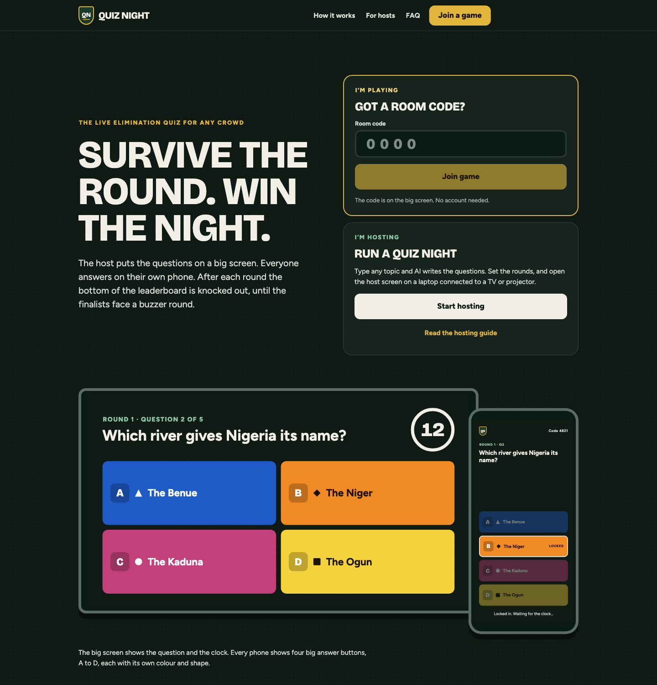

Kahoot gives everyone a participation trophy. Quiz Night brings back the school quiz competition: each round has a cut, ties are settled by speed, the knocked-out keep playing as spectators, and the final is decided on the buzzer.

## How a game runs

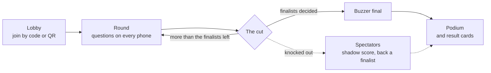

1. **Host:** the host opens the site on a laptop connected to a TV or projector, picks the rules, and optionally types a topic for AI-written questions. The room gets a 4-digit code and a QR code.
2. **Join:** players scan the QR code or type the code on their phones, and pick a nickname.
3. **Rounds:** each question shows on every screen at once with a countdown. The server keeps the time, so late answers don't count. Faster correct answers score more, from 500 to 1,000 points.
4. **The cut:** at the end of each round, the server ranks everyone and knocks out the bottom group, in one database transaction. The projector reveals them one by one, each with a farewell line from the host.
5. **Buzzer final:** the last finalists buzz in. The first valid buzz answers, and a wrong answer locks that player out of the question.
6. **Podium:** the winner, who backed them, and a shareable result card for every player.

## The big screen

| Lobby | Question |
|---|---|
| 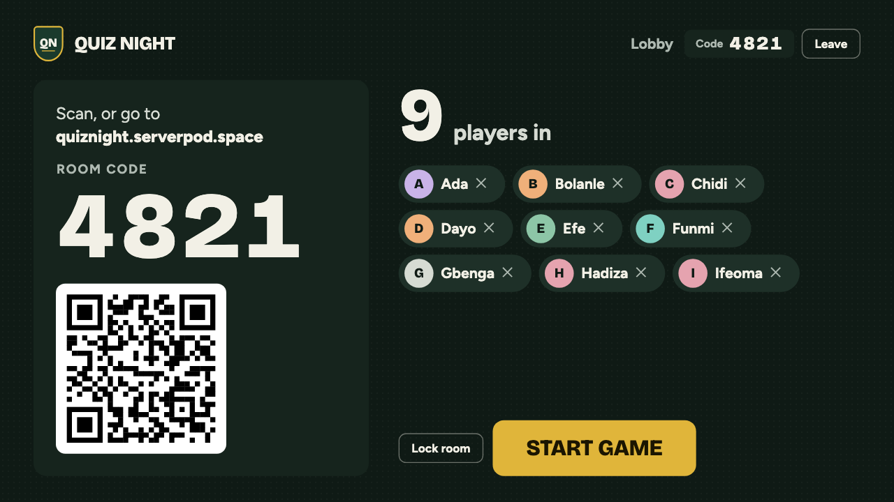 | 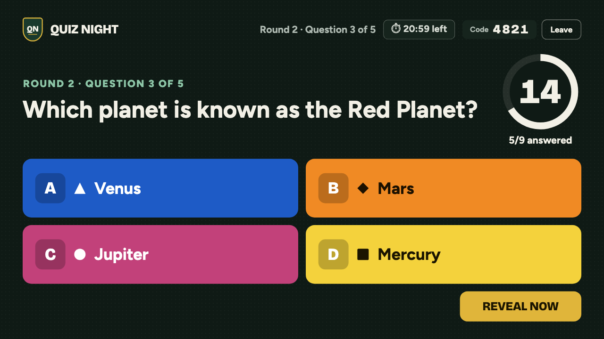 |
| **Leaderboard and danger line** | **The cut** |
| 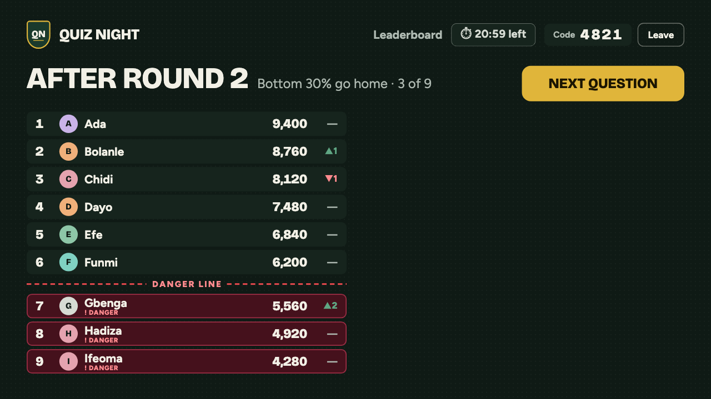 | 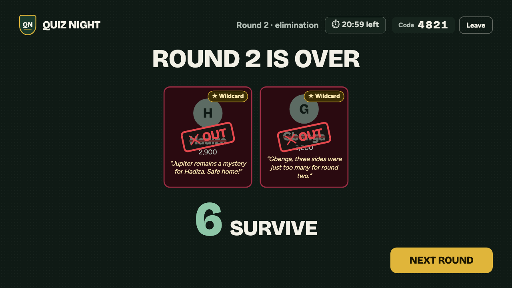 |
| **Buzzer final** | **Podium** |
| 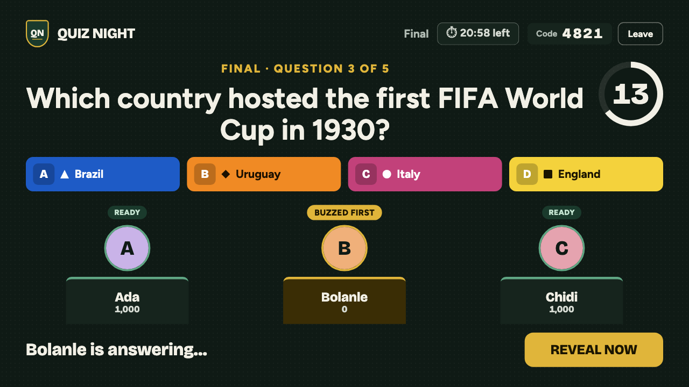 | 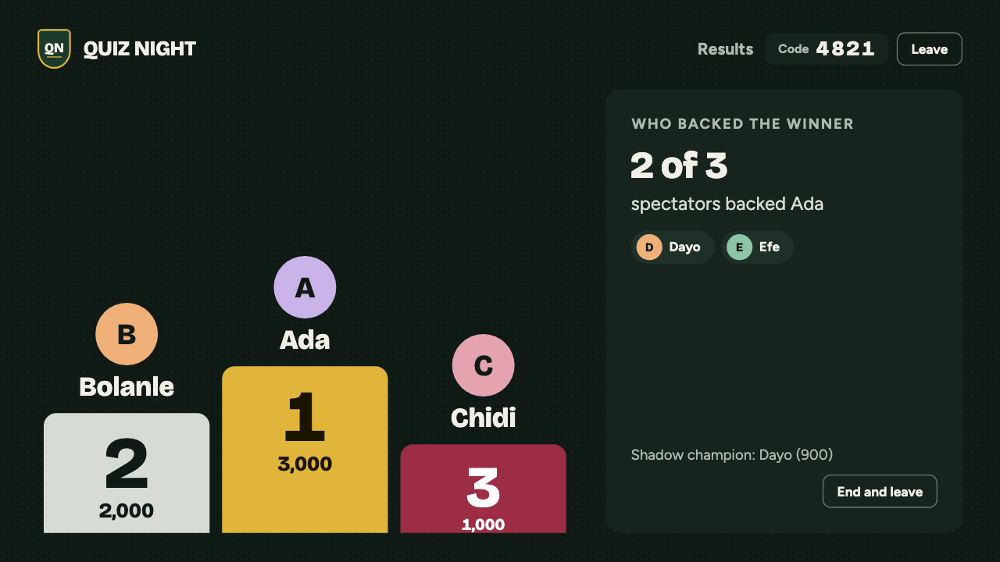 |

## On the phones

| Answering | Knocked out | Buzzer final | Result card |
|---|---|---|---|
| 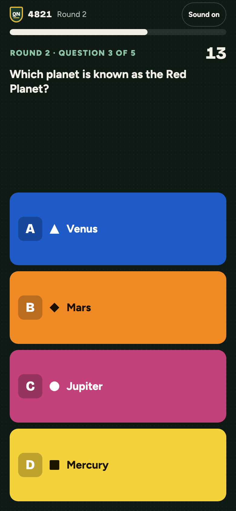 | 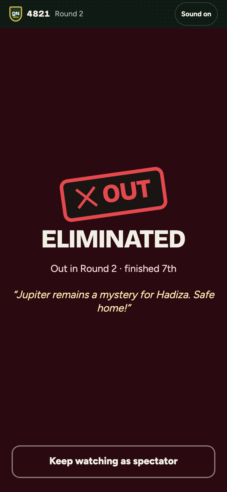 | 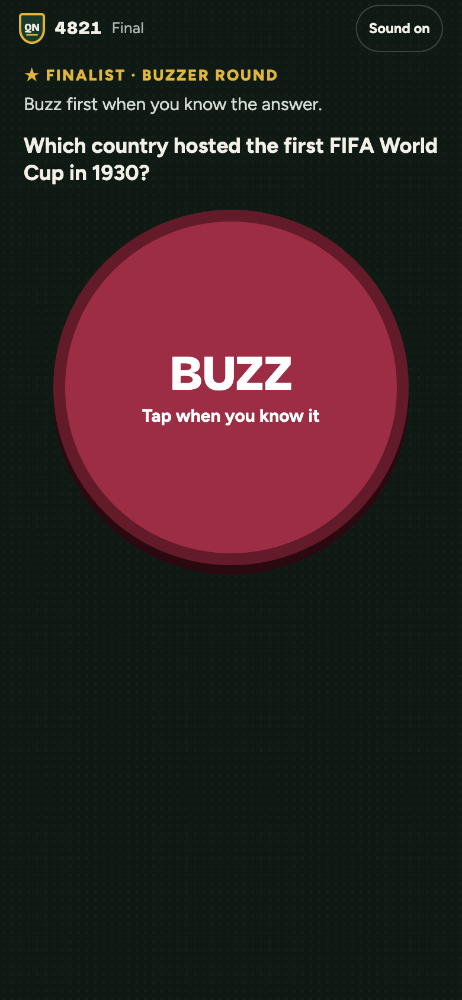 | 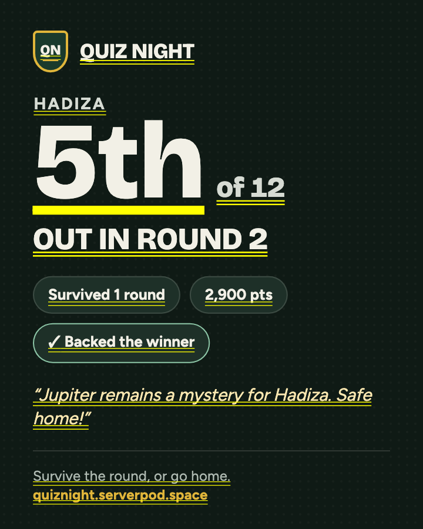 |

## Features

- **Live sync for up to 20 players per room:** questions, answers, reveals and the leaderboard stream to every screen at the same moment. A phone that sleeps or reloads reconnects straight back into the game.
- **Elimination rules:**
  - **Bottom 30%:** the default; the lowest 30% go home each round.
  - **Auto-scaled:** any room size reaches the finalists in the same number of rounds.
  - **Sudden death:** a wrong answer sends you home.
  - Ties at the cutoff go to the faster player, and the host has one wildcard to rescue a player.
- **The cut as a show:** face-down cards flip to an OUT stamp one at a time, with a drumroll, a stamp sound, a pause before the last name, and a fanfare for the finalists. The sounds are generated in the browser, so there are no audio files to download.
- **AI questions:** the host types any topic, picks a difficulty and 10–40 questions, previews them with the answers, and removes any they don't like. Every question is checked: four distinct options, no answer given away in the question, no duplicates, shuffled options.
- **AI host lines:** after each cut, Gemini writes each eliminated player a short, kind farewell line about the question they missed. Built-in lines are used when AI is off or slow.
- **Spectators:** eliminated players keep answering for a shadow score and back a finalist.
- **Fair buzzer:** the server decides the first valid buzz with a row lock, so two buzzes can never both win.
- **Result cards:** a 1080×1350 image to share, with your place, rounds survived, points, whether you backed the winner, and the host's line.
- **Safety:**
  - rate limits on every endpoint, and a block after 6 wrong room codes;
  - room lock, a 30-minute game clock, and idle rooms closed;
  - all room data deleted after a day;
  - a nickname filter, security headers (CSP, HSTS), and constant-time token checks.
- **Mobile first:** one Flutter web app for the projector, the players and the website. It loads with a lightweight HTML screen, and the fonts are subset to keep downloads small.

## How it's built

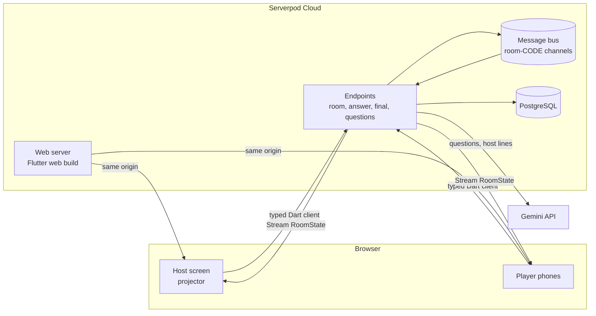

| Part | What |
|---|---|
| **Backend** | [Serverpod](https://serverpod.dev) 4 (Dart): endpoints, ORM, migrations, and live streams over its message bus. The server is the source of truth for time, scores, cuts and buzzes. |
| **Frontend** | Flutter web, with flutter_bloc (Cubits), go_router, and design-token theming. The client code is generated by Serverpod, including the streams. |
| **AI** | Google Gemini over REST with JSON-schema replies. `gemini-3.5-flash`, falling back to `gemini-3.1-flash-lite` when it's busy. |
| **Hosting** | Serverpod Cloud serves the API and the web app from one address, behind a CDN. |
| **CI/CD** | GitHub Actions: analyze, test and a web size budget on every PR. Merging to `main` deploys, smoke-tests the live site, and tags a release. |

### Project layout

```
quiz_night_server/    Serverpod server
  lib/src/models/       data models (*.spy.yaml) → generated code
  lib/src/endpoints/    the API the app calls
  lib/src/game/         rooms, scoring, the cut, the buzzer final
  lib/src/ai/           Gemini question packs and host lines
  lib/src/security/     rate limits, tokens, client address
  migrations/           database migrations
quiz_night_client/    generated client (never edit by hand)
quiz_night_flutter/   Flutter web app
  lib/features/         landing, join, host setup, room (host + phone screens)
  lib/widgets/          design-system components
  lib/core/             theme tokens, platform (haptics, sounds, sharing)
docs/                 product spec and screenshots
```

## Run it locally

You need [Flutter](https://docs.flutter.dev/get-started/install) 3.44 (Dart 3.12). The setup step below installs the Serverpod CLI. The development database runs as an embedded PostgreSQL that Serverpod starts for you, so there's no Docker.

```bash
make setup
```

Copy the password template and fill in your own values:

```bash
cp quiz_night_server/config/passwords.example.yaml quiz_night_server/config/passwords.yaml
```

To turn on AI questions and host lines, add a free [Google AI Studio](https://aistudio.google.com/apikey) key as `geminiApiKey` under `development:` in that file. Without it, the game uses the built-in questions and lines. `passwords.yaml` is gitignored, so never commit it.

Start the server and the app, with hot reload:

```bash
make start
```

To play with real phones on your network:

```bash
make phone-build
```

### Commands

Run `make` to list them all. The main ones:

| Command | What it does |
|---|---|
| `make start` | Server and app with hot reload (localhost) |
| `make phone-build` | Rebuild the web app and serve it to phones through ngrok |
| `make check` | Analyze and test everything; run before committing |
| `make generate` | Regenerate server and client code after changing models or endpoints |
| `make migration` | Create a database migration after changing a model with a table |
| `make build-web` | Build the web app into the server, as deploys do |
| `make shots` | Re-render the screenshots in this README |

### Tests

```bash
make check
```

This runs:
- **Server tests:** unit tests (the cut logic, scoring, AI checks) and integration tests against a real database.
- **App tests:** cubit and widget tests, including layout checks at phone, tablet and 1080p projector sizes with the longest names and questions.

## Deploy and releases

[DEPLOY.md](DEPLOY.md) covers Serverpod Cloud, the GitHub setup and the day-before-the-demo checklist.

```
feature branch ──PR──▶ develop ──PR──▶ main ──merge──▶ deploy ──▶ smoke test ──▶ release vX.Y.Z
```

- **PRs into `develop` and `main`** run three CI checks: `server`, `app` and `web` (a 1,200 KB web size budget). `main` accepts changes only through a PR with all three passing.
- **Merging into `main`** deploys to Serverpod Cloud, smoke-tests the live site, and publishes a [GitHub Release](https://github.com/clembabs/quiz-night/releases).
- **Release numbers** come from the Conventional Commits since the last release, and the notes are grouped into Features, Fixes and Maintenance.

## Contributing

- **Branches:** branch from `develop` (`feature/…`, `fix/…`, `chore/…`) and open the PR into `develop`. The [PR template](.github/pull_request_template.md) lists what to check.
- **Commits:** [Conventional Commits](https://www.conventionalcommits.org) such as `feat(server): …`, `fix(flutter): …` or `test: …`, with features and their tests in separate commits.
- **Models:** after changing a model, run `make generate` and, for tables, `make migration`.
- **Secrets:** keep them out of git. `config/passwords.yaml` and `.env` are ignored, and GitHub secret scanning is on.

[docs/quiz-night-spec.md](docs/quiz-night-spec.md) is the full product spec, written independently of the stack for a possible rebuild in another stack.
