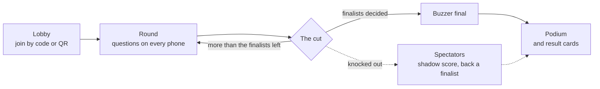

# Quiz Night

**Survive the round, or go home.** A live elimination quiz for any crowd: the questions go on a big screen, everyone answers on their own phone, and after each round the bottom of the leaderboard is knocked out, until the last finalists face off in a buzzer final.

**Play it:** <https://quiznight.serverpod.space/>. Open it on a laptop to host, then scan the QR code on your phone to join. No app or account needed.

Kahoot gives everyone a participation trophy. Quiz Night brings back the school quiz competition: each round has a cut, ties are settled by speed, the knocked-out keep playing as spectators, and the final is decided on the buzzer.

## How a game runs

1. **Host:** the host opens the site on a laptop connected to a TV or projector, picks the rules, and optionally types a topic for AI-written questions. The room gets a 4-digit code and a QR code.
2. **Join:** players scan the QR code or type the code on their phones, and pick a nickname.
3. **Rounds:** each question shows on every screen at once with a countdown. The server keeps the time, so late answers don't count. Faster correct answers score more, from 500 to 1,000 points.
4. **The cut:** at the end of each round, everyone is ranked and the bottom group is knocked out. The projector reveals them one by one, each with a farewell line from the host.
5. **Buzzer final:** the last finalists buzz in. The first valid buzz answers, and a wrong answer locks that player out of the question.
6. **Podium:** the winner, who backed them, and a shareable result card for every player.

## The big screen

| Lobby | Question |
|---|---|
|  |  |
| **Leaderboard and danger line** | **The cut** |
|  |  |
| **Buzzer final** | **Podium** |
|  |  |

## On the phones

| Answering | Knocked out | Buzzer final | Result card |
|---|---|---|---|
|  |  |  |  |

## Features

- **Everyone in sync, up to 20 players a room:** questions, answers, reveals and the leaderboard reach every screen at the same moment. A phone that sleeps or reloads goes straight back into the game.
- **Elimination rules:**
  - **Bottom 30%:** the default; the lowest 30% go home each round.
  - **Auto-scaled:** any room size reaches the finalists in the same number of rounds.
  - **Sudden death:** a wrong answer sends you home.
  - Ties at the cutoff go to the faster player, and the host has one wildcard to rescue a player.
- **The cut as a show:** face-down cards flip to an OUT stamp one at a time, with a drumroll, a stamp sound, a pause before the last name, and a fanfare for the finalists.
- **AI questions:** the host types any topic, picks a difficulty and 10–40 questions, previews them with the answers, and removes any they don't like. Every question is checked: four distinct options, no answer given away in the question, no duplicates, shuffled options.
- **AI host lines:** after each cut, Gemini writes each eliminated player a short, kind farewell line about the question they missed. Built-in lines are used when AI is off or slow.
- **Spectators:** eliminated players keep answering for a shadow score and back a finalist.
- **Fair buzzer:** the server decides who buzzed first, so two buzzes can never both win.
- **Result cards:** a 1080×1350 image to share, with your place, rounds survived, points, whether you backed the winner, and the host's line.
- **Safe rooms:** limits on spam and code guessing, a room lock once everyone's in, a 30-minute game clock, idle rooms closed, a nickname filter, and all room data deleted after a day.
- **Any phone, no app:** it runs in the phone's browser, with no install or account, and loads quickly on mobile data.

## Built with

[Flutter](https://flutter.dev) on the web, a [Serverpod](https://serverpod.dev) backend on Serverpod Cloud, and Google Gemini for the AI-written questions and host lines.

Working on the code? See [docs/DEVELOPMENT.md](docs/DEVELOPMENT.md).
