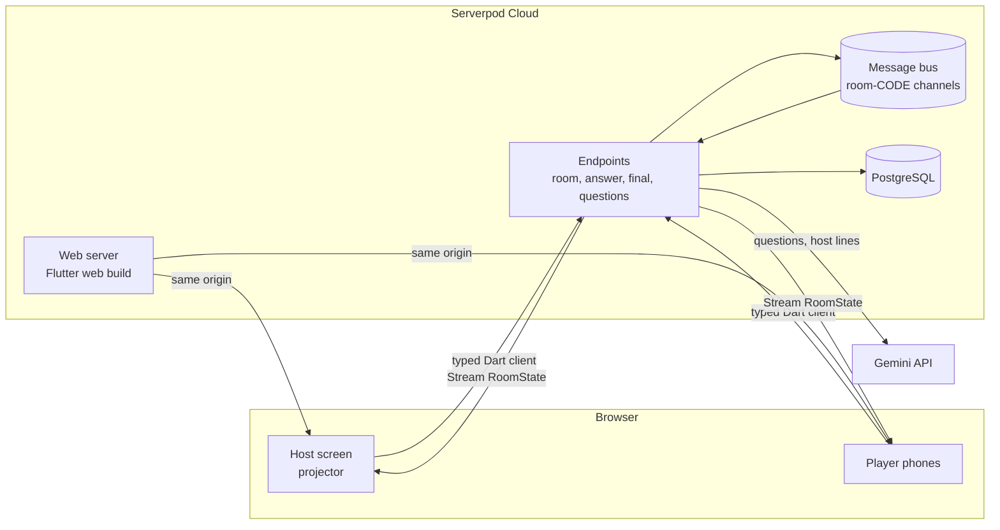

# Developing Quiz Night

How the app is built, how to run it, and how changes reach production. For what the app does, see the [README](../README.md).

## How it's built



| Part | What |
|---|---|
| **Backend** | [Serverpod](https://serverpod.dev) 4 (Dart): endpoints, ORM, migrations, and live streams over its message bus. The server is the source of truth for time, scores, cuts and buzzes. |
| **Frontend** | Flutter web, with flutter_bloc (Cubits), go_router, and design-token theming. The client code is generated by Serverpod, including the streams. |
| **AI** | Google Gemini over REST with JSON-schema replies. `gemini-3.5-flash`, falling back to `gemini-3.1-flash-lite` when it's busy. |
| **Hosting** | Serverpod Cloud serves the API and the web app from one address, behind a CDN. |
| **CI/CD** | GitHub Actions: analyze, test and a web size budget on every PR. Merging to `main` deploys, smoke-tests the live site, and tags a release. |

### Project layout

```
quiz_night_server/    Serverpod server
  lib/src/models/       data models (*.spy.yaml) → generated code
  lib/src/endpoints/    the API the app calls
  lib/src/game/         rooms, scoring, the cut, the buzzer final
  lib/src/ai/           Gemini question packs and host lines
  lib/src/security/     rate limits, tokens, client address
  migrations/           database migrations
quiz_night_client/    generated client (never edit by hand)
quiz_night_flutter/   Flutter web app
  lib/features/         landing, join, host setup, room (host + phone screens)
  lib/widgets/          design-system components
  lib/core/             theme tokens, platform (haptics, sounds, sharing)
docs/                 product spec and screenshots
```

## Run it locally

You need [Flutter](https://docs.flutter.dev/get-started/install) 3.44 (Dart 3.12). The setup step below installs the Serverpod CLI. The development database runs as an embedded PostgreSQL that Serverpod starts for you, so there's no Docker.

```bash
make setup
```

Copy the password template and fill in your own values:

```bash
cp quiz_night_server/config/passwords.example.yaml quiz_night_server/config/passwords.yaml
```

To turn on AI questions and host lines, add a free [Google AI Studio](https://aistudio.google.com/apikey) key as `geminiApiKey` under `development:` in that file. Without it, the game uses the built-in questions and lines. `passwords.yaml` is gitignored, so never commit it.

Start the server and the app, with hot reload:

```bash
make start
```

To play with real phones on your network:

```bash
make phone-build
```

### Commands

Run `make` to list them all. The main ones:

| Command | What it does |
|---|---|
| `make start` | Server and app with hot reload (localhost) |
| `make phone-build` | Rebuild the web app and serve it to phones through ngrok |
| `make check` | Analyze and test everything; run before committing |
| `make generate` | Regenerate server and client code after changing models or endpoints |
| `make migration` | Create a database migration after changing a model with a table |
| `make build-web` | Build the web app into the server, as deploys do |
| `make shots` | Re-render the README screenshots |
| `make demo-players CODE=K7QM` | Fill a room with demo players, for rehearsals and demo videos |

### Demo players

`make demo-players CODE=K7QM COUNT=8` joins up to 15 players to a room on the live site (add `API=http://localhost:8080` for a local server). They run on your machine and use the public API like phones do: no server change, no special mode. They never see the right answer, so they guess, at a random point in each countdown; in the final some buzz, and the knocked-out ones back a finalist. Ctrl+C makes them leave; after the podium they stay.

### Tests

```bash
make check
```

This runs:
- **Server tests:** unit tests (the cut logic, scoring, AI checks) and integration tests against a real database.
- **App tests:** cubit and widget tests, including layout checks at phone, tablet and 1080p projector sizes with the longest names and questions.

## Deploy and releases

[DEPLOY.md](../DEPLOY.md) covers Serverpod Cloud, the GitHub setup and the day-before-the-demo checklist.

```
feature branch ──PR──▶ develop ──PR──▶ main ──merge──▶ deploy ──▶ smoke test ──▶ release vX.Y.Z
```

- **PRs into `develop` and `main`** run three CI checks: `server`, `app` and `web` (a 1,200 KB web size budget). `main` accepts changes only through a PR with all three passing.
- **Merging into `main`** deploys to Serverpod Cloud, smoke-tests the live site, and publishes a [GitHub Release](https://github.com/clembabs/quiz-night/releases).
- **Release numbers** come from the Conventional Commits since the last release, and the notes are grouped into Features, Fixes and Maintenance.

## Contributing

- **Branches:** branch from `develop` (`feature/…`, `fix/…`, `chore/…`) and open the PR into `develop`. The [PR template](../.github/pull_request_template.md) lists what to check.
- **Commits:** [Conventional Commits](https://www.conventionalcommits.org) such as `feat(server): …`, `fix(flutter): …` or `test: …`, with features and their tests in separate commits.
- **Models:** after changing a model, run `make generate` and, for tables, `make migration`.
- **Secrets:** keep them out of git. `config/passwords.yaml` and `.env` are ignored, and GitHub secret scanning is on.

[quiz-night-spec.md](quiz-night-spec.md) is the full product spec, written independently of the stack for a possible rebuild in another stack.
